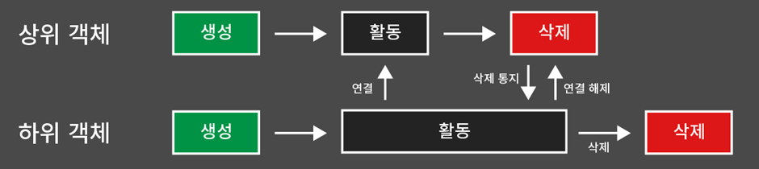
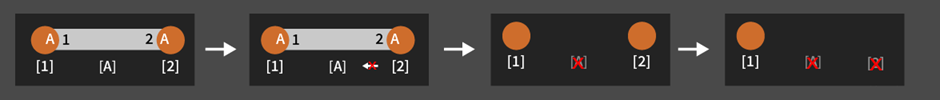
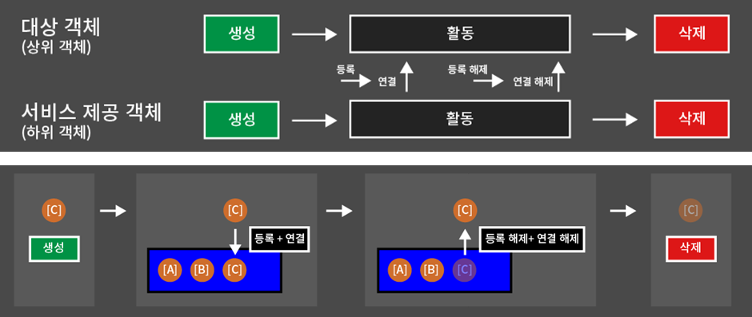
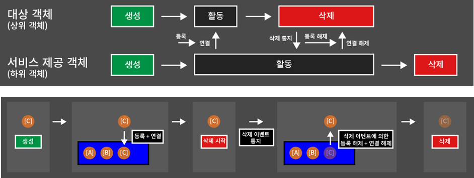
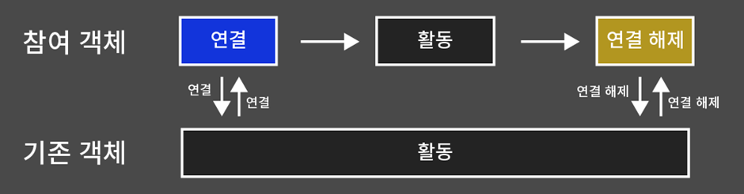

# 객체 활동과 연결 원칙

## 개요

- UniEngine이 지향하는 개발 환경과 객체의 활동 원칙을 제시한다.
- 두 객체가 서로 연결되어 정보를 교환하는 상황에서 활동 원칙이 어떻게 적용되는지 소개한다.
- 객체의 원활한 연결을 위한 모범적인 상황을 소개한다.

## 목차

1. 객체 활동 원칙
2. 객체의 연결
3. 계층형 연결과 참여형 연결

## 1. 객체 활동 원칙

UniEngine은 객체 지향 원칙을 기반으로 한 자유로운 개발 환경을 제공하는 것을 목표로 한다. 객체는 각자의 생애주기 내에서 자신에게 부여된 목표를 달성하기 위해 활동하며, 이를 통해 전체 시스템의 목표가 달성된다.

UniEngine은 아래와 같이 객체를 정의한다.

- 객체: 일정한 목적을 가지고 시스템에 존재하는 독립적인 개체
- 객체는 ‘생성 – 활동 – 삭제’의 생애주기를 가진다.

객체는 스스로의 목적을 이루기 위해 시스템 내에서 적극적으로 행동할 자유를 가지며, 동시에 다른 객체의 활동을 침해하지 않아야 하는 책임을 가진다.

객체가 누릴 수 있는 자유에 대한 원칙은 다음과 같다.

- 자유 원칙: 객체는 자신의 생애주기 동안 다른 객체나 시스템에 의해 간섭이나 제약을 받지 않고 활동할 수 있다.
    1. 생성과 삭제의 자유: 객체는 다른 객체나 시스템에 영향을 받지 않고 독립적으로 생성되거나 삭제될 수 있다.
    2. 활동의 자유: 객체는 자신의 목적을 수행하는 범위 내에서, 다른 객체의 상태나 활동에 방해받지 않고 자유롭게 활동할 수 있다.

객체가 시스템에 존재하는 모든 객체의 자유를 보장하기 위해 지켜야 하는 책임에 대한 원칙은 다음과 같다.

- 책임 원칙: 객체는 다른 객체의 활동을 침해해서는 안 된다.
    1. 삭제의 무결성: 객체는 삭제될 때 다른 객체의 활동을 방해할 수 있는 데이터를 남겨서는 안 된다.
    2. 활동의 존중: 객체는 다른 객체의 활동 영역을 침범하여 해당 객체의 자유를 침해해서는 안 된다.

둘 이상의 객체를 통해 기능을 구현하는 시스템의 경우, 시스템을 구성하는 객체들의 자유와 책임이 서로 충돌할 수 있다. 이때 개발자는 중재 장치를 마련하거나 각 객체의 활동 범위를 설정하는 등의 조치를 취하여 객체들이 원활하게 활동할 수 있는 환경을 마련해야 한다.

## 2. 객체의 연결

### 2-1. 객체 연결 소개

객체의 연결이란 두 객체가 접촉하여 서로의 활동에 필요한 정보를 주고받는 것을 뜻한다.
UniEngine에서는 객체 연결을 연결의 지속성 여부에 따라 패시브 연결과 액티브 연결로 구분한다.

#### 2-1-1. 패시브 연결

패시브 연결은 정보 교환 후 연결이 즉시 해제되는 일회성 방식의 연결이다.

- 장점: 단순하고 가벼운 연결, 객체 생애주기에 영향을 미치지 않음
- 단점: 정보 교환 후 연결이 끊기기 때문에 외부 도움 없이는 추가적인 정보 교환이 불가능
- 주요 사용 예시: 객체의 `public` 인자를 통한 정보 교환

```csharp
void Run()
{
    var subject = new Subject();
    var data = new Data();

    subject.Read(data);
}

class Subject
{
    public void Read(Data data) =>
        Console.WriteLine(data.Value);
}

class Data
{
    public int Value { get; set; } = 1;
}
```


#### 2-1-2. 액티브 연결

액티브 연결은 정보 교환 이후에도 연결 상태가 유지되는 방식이다.

- 장점: 정보 교환 후에도 연결이 유지되어 외부 도움 없이도 추가적인 정보 교환 가능
- 단점: 상대적으로 복잡한 연결, 연결에 참여하는 객체 중 하나가 임의로 삭제될 때 유효하지 않은 연결이 남아 삭제의 무결성 원칙을 위반할 가능성이 있음
- 주요 사용 예시: 정보 제공자가 수신자를 호출하여 정보 교환

```csharp
void Run()
{
    var subject = new Subject();
    var data = new Data();

    subject.Connect(data);
    data.ChangeValue(10);
}

class Subject
{
    public void Connect(Data data) =>
        data.Event += OnValueChanged;

    void OnValueChanged(int value) =>
        Console.WriteLine(value);
}

class Data
{
    public Action<int> Event;
    private int _value;

    public void ChangeValue(int value)
    {
        _value = value;
        Event?.Invoke(_value);
    }
}
```

### 2-2. 객체 연결 상황에서의 활동 원칙 구현

원활한 개발 환경을 위해, 모든 객체는 앞에서 살펴본 객체 활동 원칙을 준수해야 한다. 이는 객체가 연결을 맺는 상황에서도 구현되어야 한다.

#### 2-2-1. 패시브 연결

패시브 연결 방식에서는 둘 이상의 객체가 정보를 교환한 후 즉시 연결이 해제된다. 이러한 특성상 객체 활동 원칙이 침해될 가능성은 낮다.

하지만 하나 이상의 객체가 준비되지 않은 상황에서 정보를 교환하거나 멀티 스레드 환경에서 하나의 데이터를 동시에 작성하는 등 예기치 못한 위험이 발생할 수 있으므로, 개발자는 프로그램 설계 단계에서 이러한 상황이 발생하지 않도록 적절한 방안을 마련해야 한다.

#### 2-2-2. 액티브 연결

액티브 연결 방식에서는 객체 간 연결이 정보 교환 후에도 유지된다. 이러한 특성으로 인해, 연결된 객체 중 하나가 삭제될 경우 삭제의 무결성 원칙을 위반하여 유효하지 않은 연결이 남을 가능성이 있다.

이러한 현상을 방지하기 위해 개발자는 객체가 삭제될 때 직접 연결을 제거하거나, 객체가 삭제될 때 삭제 이벤트를 다른 객체에게 통보하게 하여 불필요한 연결이 자동으로 삭제될 수 있게 하는 등의 방법을 마련해야 한다.

아래 두 예시는 액티브 연결에서 삭제의 무결성 원칙을 준수할 수 있도록 작성한 것이다.

> 객체가 삭제될 때 직접 연결을 제거하는 방식의 예시

```csharp
class Manager
{
    public void Run()
    {
        var school = new School();
        var student = new Student() { Name = "Maru" };

        school.Add(student);
        school.PrintAllStudents();

        // Remove Student

        school.Remove(student);
        student.Dispose();
        school.PrintAllStudents();
    }
}

class School
{
    private List<Student> _students = new();

    public void Add(Student student) =>
        _students.Add(student);

    public void Remove(Student student) =>
        _students.Remove(student);

    public void PrintAllStudents()
    {
        if (_students.Any())
            _students.ForEach(s => Console.WriteLine(s.Name));
        else
            Console.WriteLine("There are no students in the school.");
    }
}

class Student : IDisposable
{
    public string Name { get; set; }
    public bool IsDisposed { get; private set; } = false;

    public void Dispose()
    {
        if (IsDisposed) return;
        IsDisposed = true;
    }
}
```


> 객체가 삭제될 때 삭제 이벤트를 다른 객체에게 통보하여 불필요한 연결이 자동으로 삭제될 수 있도록 하는 방식의 예시

```csharp
class Manager
{
    public void Run()
    {
        var school = new School();
        var student = new Student() { Name = "Maru" };

        school.Add(student);
        school.PrintAllStudents();

        // Remove Student

        student.Dispose();
        school.PrintAllStudents();
    }
}

class School
{
    private List<Student> _students = new();

    public void Add(Student student)
    {
        _students.Add(student);
        student.OnDisposed += Remove;
    }

    public void Remove(Student student)
    {
        _students.Remove(student);
        student.OnDisposed -= Remove;
    }

    public void PrintAllStudents()
    {
        if (_students.Any())
            _students.ForEach(s => Console.WriteLine(s.Name));
        else
            Console.WriteLine("There are no students in the school.");
    }
}

class Student : IDisposable
{
    public string Name { get; set; }
    public bool IsDisposed { get; private set; } = false;
    public Action<Student> OnDisposed;

    public void Dispose()
    {
        if (IsDisposed) return;
        IsDisposed = true;

        OnDisposed?.Invoke(this);
        OnDisposed = null;
    }
}
```

## 3. 계층형 연결과 참여형 연결

### 3-1. 계층형 연결

둘 이상의 객체가 동시에 수신자와 발신자가 되어 정보를 교환하는 경우, 서로의 신호가 중복되어 의도하지 않은 상황이 발생할 수 있으며, 이를 처리하기 위해 복잡한 알고리즘이 필요하게 될 수 있다. 이때 연결에 참여하는 객체들을 수신자 역할과 발신자 역할로 구분하고, 정보를 발신자로부터 수신자에게로만 전달되도록 하면 상황을 단순화하고 정보 처리 비용을 낮출 수 있다.

UniEngine에서는 이러한 연결을 ‘계층형 연결’이라고 한다.
UniEngine은 아래와 같이 계층형 연결에 사용되는 객체를 정의한다.

- 상위 객체: 자신의 활동에 다른 객체의 정보를 필요로 하지 않는 독립적인 객체 (정보 발신자)
- 하위 객체: 자신의 활동에 상위 객체의 정보를 필요로 하는 객체 (정보 수신자)

계층형 연결에 참여하는 객체들은 모두 객체 활동 원칙을 따른다. 즉, 상위 객체와 하위 객체는 모두 연결에 관계없이 자유롭게 생성될 수 있고, 자유롭게 활동할 수 있으며, 자유롭게 삭제될 수 있다. 동시에, 상위 객체와 하위 객체는 서로의 활동 범위를 침범하여 상대 객체의 활동에 지장을 주어서는 안 되며, 자신이 삭제될 때는 연결을 해제함으로써 참조를 상대 객체 안에 남기지 않도록 해야 한다.

계층형 연결이 원활하게 구성되기 위해서, 연결에 참여하는 객체는 아래의 원칙을 따라야 한다.

- 상위 객체 독립성: 상위 객체는 하위 객체로부터 정보를 전달받을 수 없으므로, 연결의 성립 여부와 관계없이 활동할 수 있어야 한다.
- 예외 처리 원칙: 하위 객체는 상위 객체와 연결하여 활동하는 중 상위 객체가 예기치 않게 삭제될 때에 대한 예외 처리가 구현되어 있어야 한다. 특별한 예외 처리를 구현하지 않는 경우, 상위 객체가 삭제되면 하위 객체도 함께 삭제되는 것을 원칙으로 한다.

아래는 다양한 계층형 연결의 예시이다.

#### 3-1-1. 의존 연결

의존 연결은 하위 객체가 상위 객체를 필수 속성으로 삼아 연결하는 것을 의미한다.

하위 객체는 자신의 활동에 상위 객체가 필요함을 전제로 하며, 상위 객체가 삭제되면 하위 객체도 함께 삭제되는 것을 원칙으로 한다.



> 의존 연결에서 상위 객체의 삭제


예를 들어 아래와 같이 Segment가 Node를 필수 속성으로 하여 연결을 맺는 의존 연결 네트워크에서는 상위 객체인 Node가 삭제되면 연결된 Segment도 함께 삭제되어야 한다.

이를 위해 Node는 삭제 전에 연결된 Segment들에게 삭제 통지를 보내야 하며, 통지를 받은 Segment는 모든 연결을 해제한 후 자신을 삭제해야 한다.



> 의존 연결에서 상위 객체의 삭제 예시


#### 3-1-2. 서비스 제공 연결

서비스 제공 연결은 하나의 하위 객체(서비스 제공 객체)가 하나 이상의 상위 객체(대상 객체)를 관리하기 위해 연결하는 것을 의미한다. 이때 하위 객체는 상위 객체들을 자신의 내부에 저장하여 관리한다.

서비스 제공 객체는 대상 객체를 항상 유효한 상태로 관리하는 것을 목표로 한다. 이를 위해 서비스 제공 객체는 대상 객체가 연결되는 즉시 해당 객체를 자신의 리스트에 추가하고 대상 객체가 삭제되는 즉시 리스트에서 이를 제거하여 대상 객체의 리스트를 항상 유효한 상태로 유지한다.



> 서비스 연결에서 객체의 생애주기와 예시 – 일반적인 경우




> 서비스 연결에서 객체의 생애주기와 예시 – 상위 객체가 먼저 삭제되는 경우

### 3-2. 참여형 연결

계층형 연결의 경우 정보가 발신자로부터 수신자에게로만 전달되기 때문에, 시스템을 원활하게 사용하기 위해서는 이러한 계층 구조를 사전에 숙지하고 있어야 한다. 이는 복잡한 상황에서 직관적인 프로그래밍을 어렵게 할 수 있으며, 비교적 경직된 구조를 가지고 있기 때문에 동적으로 변하는 상황에 대응하기 힘들 수 있다.

참여형 연결은 연결에 참여하는 객체가 이미 연결에 참여하고 있는 객체들에게 방해가 되지 않도록 연결되는 방식으로, 각 객체가 자신의 연결 활동을 책임짐으로써 지속 가능한 연결 환경을 구축할 수 있다.

참여형 연결은 아래 과정으로 진행된다.

**연결 시**
- 연결을 맺으려는 객체가 연결할 객체들에게 자신이 연결된다는 사실을 알린다.
- 연결된 객체들은 해당 알림을 받은 뒤 필요한 처리를 하여 연결에 참여 중인 모든 객체들의 네트워크가 정상적으로 유지되도록 한다.

**연결 해제 시**
- 연결을 해제하는 객체가 연결된 상대 객체들에게 연결 해제 사실을 알린다.
- 통보를 받은 객체들은 해당 객체와의 연결을 해제하여 연결에 유효하지 않은 참조가 남지 않도록 한다.



> 참여형 연결의 과정

참여형 연결의 객체들은 자신이 발신자가 될 수도, 수신자가 될 수도 있기 때문에, 다른 객체에 연결할 수 있는 인터페이스와 자신이 연결 요청을 받았을 때 이를 처리하는 메서드를 동시에 가지고 있는 경우가 많다. 이들 간에 연결이 진행될 경우, 두 객체에 존재하는 메서드가 대칭적으로(상호적으로) 호출되어 각자가 필요한 부분을 설정하는 역할을 할 수 있다.
