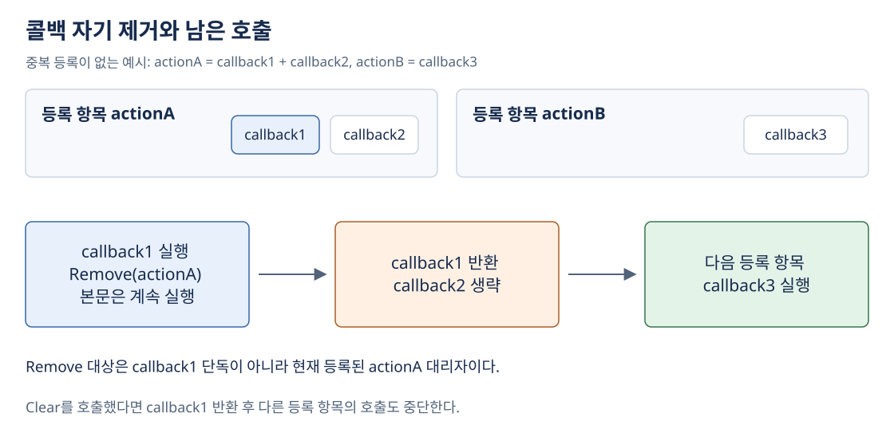

# AdaptiveAction

순회 중 콜백 변경과 수신자 예외 격리를 지원하는 호출 목록이다.

## 목차

1. 역할과 구성
2. 동작 흐름
3. 설계 기준과 고려사항
4. 구현 연결

## 역할과 구성

- 책임: 순회 중 콜백 변경과 실패가 호출 목록의 나머지 수신자에 미치는 영향을 제어한다.
- 보유 정보: AdaptiveCollection&lt;Action&gt; 계열의 저장 목록·순회 상태를 상속한다. 인자 0~3개의 형식을 제공한다.

| 제공 서비스 | 제공 이유 |
| --- | --- |
| Add·Remove·Clear | 콜백의 등록 수명을 목록에서 관리하고 제거한 항목을 이후 호출에서 제외한다. |
| Invoke | 목록의 각 항목을 실행하면서 실패한 항목을 제거하고 공통 예외 처리기로 보고한다. |

저장 항목 하나는 등록된 대리자 하나이며, 그 안에 여러 콜백이 결합되어 있을 수 있다. 외부 목록의 등록 수명은 [AdaptiveCollection](AdaptiveCollection.md)이 관리하고, 항목 내부의 멀티캐스트 호출은 AdaptiveAction이 관리한다.

## 동작 흐름

1. 등록 시 AdaptiveCollection의 OnItemAdded를 통해 내부 콜백 목록을 준비한다. AddRange와 기본 클래스·인터페이스를 통한 등록도 같은 처리를 거친다.
2. Invoke가 상속한 컬렉션을 순회하여 등록 항목과 캐시된 내부 콜백 목록을 받는다. null 항목은 건너뛰며, 매 콜백 호출 직전에 현재 저장 항목이 활성 상태인지 확인한다.
3. 콜백이 정상 반환하면 활성 상태를 다시 확인하며 다음 내부 콜백으로 진행한다. 내부 호출이 끝나면 다음 등록 항목을 방문한다.
4. 콜백이 실패하면 현재 등록 항목 전체를 제거하고 ExceptionHandler에 보고한다. 보고가 정상 반환하면 해당 항목의 남은 내부 호출을 생략하고 다음 등록 항목으로 진행한다.

[공통 변경 정책](README.md)은 이벤트 전파에서 다음과 같이 적용된다.

| 호출 도중 변경 | 이후 전파에 미치는 영향 |
| --- | --- |
| 기본 지연 모드에서 등록 | 추가 대기 목록에 보관하고 다음 Invoke부터 방문한다. |
| 즉시 모드에서 등록 | 저장 목록 뒤에 추가하여 같은 Invoke의 후속 항목으로 방문할 수 있다. |
| 현재 등록 항목 제거 | 현재 콜백이 반환된 뒤 같은 항목의 남은 내부 호출을 중단한다. 다른 등록 항목의 순회는 계속한다. |
| 아직 방문하지 않은 등록 항목 제거 | 해당 항목을 이후 호출에서 제외한다. |
| Clear | 현재 콜백이 반환된 뒤 남은 내부 호출과 외부 순회를 중단한다. 이후 추가된 항목은 다음 Invoke에서 방문한다. |

정상 종료·조기 종료·예외 전파 시에는 외부 열거자가 폐기되어 컬렉션의 대기 항목 반영과 순회 상태 복구가 이루어진다.

## 설계 기준과 고려사항

목록의 변경 정책은 AdaptiveCollection에 두고 대리자 호출과 실패 격리는 AdaptiveAction에 둔다. GetInvocationList로 얻은 배열만 계속 호출하면 이미 해제된 등록 항목의 나머지 콜백도 실행될 수 있으므로, 각 호출 전에 컬렉션의 현재 항목 상태를 확인한다. 이는 제거된 연결을 이후 호출에서 제외하는 정책을 항목 내부에도 적용하기 위한 검사이다.

- 이미 실행 중인 콜백 본문을 강제로 취소하지 않는다. 자기 제거와 Clear의 효과는 그 콜백이 반환된 뒤 다음 호출을 결정할 때 적용된다.
- Remove는 컬렉션에서 첫 일치 항목을 제거한다. 중복 등록이 있으면 제거된 항목이 현재 실행 중인 항목인지에 따라 내부 호출의 지속 여부가 달라진다.
- [ExceptionHandler](../../01-Infrastructure/03-M.2-ExceptionHandler/ExceptionHandler.md)에 처리기가 없거나 처리기가 예외를 던지면 Invoke가 중단되고 예외가 호출자에게 전파된다. 실패한 항목 제거와 외부 순회 정리는 유지된다.
- 같은 인스턴스의 Invoke 도중 재귀적으로 Invoke하면 동시 활성 순회 제한에 따라 거부된다.
- GetInvocationList 배열은 등록 시 준비하여 첫 Invoke부터 재사용한다. 같은 대리자 인스턴스는 형식별 InvocationListCache를 공유하며, 약한 키를 사용하여 캐시가 제거된 대리자와 대상 객체의 수명을 연장하지 않게 한다.
- 캐시 생성은 등록 비용에 포함되며, 순회 중 처음 등록한 대리자도 마찬가지이다.
- 호출 자체가 람다를 다시 캡처하지 않는다.

## 구현 연결

[소스](../../../../src/02-Core/02-E.2-AdaptiveCollections/AdaptiveAction.cs) · [모듈 구성](README.md)
