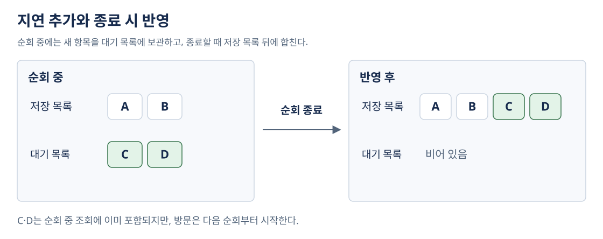
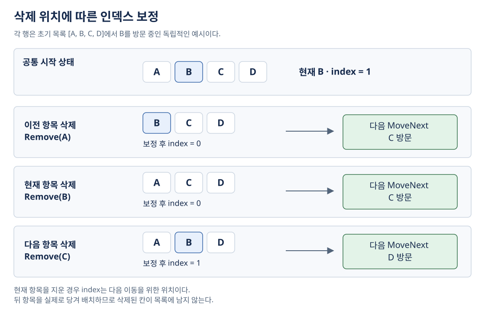

# AdaptiveCollection

순회 중 항목의 추가·삭제를 허용하면서 변경 반영 시점과 순회 상태를 관리하는 목록 기반 컬렉션이다.

## 목차

1. 역할과 구성
2. 순회와 변경 반영
3. 등록 확장
4. 검증과 구현 연결

## 역할과 구성

- 책임: 순회 중 변경 요청을 받아들이고, 각 항목을 방문할지와 변경을 저장 목록에 반영할 시점을 결정한다.
- 보유 정보: 저장 목록, 추가 대기 목록, 현재 인덱스, 순회 식별자, 중단·현재 항목 제거 상태와 DeferredUpdate 모드이다.

| 제공 서비스 | 제공 이유 |
| --- | --- |
| Add·AddRange·Remove·Clear | 순회 중에도 항목의 수명을 변경하고, 제거한 항목을 이후 방문에서 제외한다. |
| Count·Contains·CopyTo | 대기 추가를 포함한 논리 상태를 관찰하게 한다. |
| GetEnumerator·ForEach | 같은 변경 정책을 직접 순회와 콜백 순회에서 사용하게 한다. |
| IEnumerationSource의 명시적 구현 | 공통 열거자의 시작·이동·종료 요청에 맞춰 저장 목록과 순회 인덱스를 함께 관리한다. |
| OnItemAdded | 파생 클래스가 저장한 항목의 등록 정보를 준비하게 한다. |

공통 열거자와 순회 수명 계약의 구조, 순회 수명 규칙은 [모듈 개요](README.md)에서 설명한다.

목록의 항목을 제거하면 뒤 항목들의 인덱스가 앞으로 당겨진다. 다음 방문 위치를 변경 요청과 함께 보정할 수 있도록 순회 인덱스는 컬렉션이 소유한다. ValueEnumerator는 시작·이동·종료를 요청하고, 컬렉션은 저장 목록과 현재 위치를 함께 조정하여 항목을 건너뛰는 것을 막는다.

## 순회와 변경 반영

순회가 시작되면 이동마다 컬렉션이 인덱스와 현재 항목의 활성 상태를 갱신하여 다음 값을 반환한다.

순회 중이 아닐 때 추가·삭제는 저장 목록에 바로 적용한다. 순회 중 추가는 생성 시 선택한 DeferredUpdate에 따라 처리한다. 기본 지연 모드는 추가 대기 목록에 모아 두었다가 순회 종료 시 저장 목록 뒤에 합치며, 즉시 모드는 저장 목록 뒤에 바로 추가하여 이어서 방문할 수 있게 한다.

| 변경 | 기본 지연 모드 | 즉시 반영 모드 |
| --- | --- | --- |
| 추가 | 대기 목록에 보관하고 종료 시 저장 목록에 반영한다. | 저장 목록에 추가하여 같은 순회에서 방문할 수 있다. |
| 삭제 | 즉시 저장 목록에서 제거하고 필요한 인덱스를 보정한다. | 같은 방식으로 즉시 제거한다. |
| Clear | 저장·대기 목록을 비우고 현재 순회를 중단한다. | 저장 목록을 비우고 현재 순회를 중단한다. |
| Clear 이후 추가 | 다음 순회에서 읽는다. | 현재 순회는 중단된 상태이므로 다음 순회에서 읽는다. |

[공통 변경 정책](README.md)에 따라 추가의 방문 시점은 선택하고 삭제의 효과는 즉시 적용한다. Remove는 저장 목록에서 첫 일치 항목을 먼저 찾고, 없으면 지연 모드의 추가 대기 목록에서 찾는다. 중복 값을 허용하므로 한 번의 Remove가 같은 값을 가진 모든 등록 항목을 제거하지는 않는다.

| 삭제 대상 | 저장 상태와 순회 위치 처리 |
| --- | --- |
| 현재 항목보다 앞에 있는 항목 | 저장 목록에서 제거하고 현재 인덱스를 1 줄여, 다음 이동에서 미방문 항목을 건너뛰지 않게 한다. |
| 현재 항목 | 저장 목록에서 제거하고 현재 인덱스를 1 줄이며 현재 항목이 제거되었음을 기록한다. |
| 현재 항목보다 뒤에 있는 항목 | 저장 목록에서 제거하며 현재 인덱스는 유지한다. 제거한 항목은 이후 방문하지 않는다. |
| 저장 목록에 없고 추가 대기 목록에 있는 항목 | 대기 목록에서 첫 일치 항목을 제거하여 종료 시 저장 목록에 합쳐지지 않게 한다. |

현재 항목의 제거 상태는 [AdaptiveAction](AdaptiveAction.md)이 같은 항목의 남은 멀티캐스트 호출을 중단하는 데에도 사용한다. 이전 항목을 삭제하여 인덱스만 보정한 경우와 현재 항목 자체가 제거된 경우를 구분하기 위한 상태이다.

지연 모드의 Count·Contains·CopyTo는 순회에서 아직 방문하지 않는 대기 추가도 포함한다. 즉, 조회할 수 있는 논리 상태와 현재 순회의 방문 대상은 구분한다.

## 등록 확장

Add와 AddRange는 저장한 항목에 OnItemAdded를 호출하여 파생 클래스가 등록 정보를 준비하게 한다. 지연 모드에서 추가 대기 목록에 들어간 항목도 같은 시점에 호출한다. [AdaptiveAction](AdaptiveAction.md)은 이 시점에 호출 목록을 준비한다.

AddRange는 기존 목록의 일괄 추가 동작을 유지하며, 입력 열거 도중 실패해 일부 항목만 저장된 경우에도 해당 항목의 등록 처리를 수행한다.

## 검증과 구현 연결

[상태·동작 표](../../../../tests/02-Core/02-E.2-AdaptiveCollections/UniTest/01-Tables.md), [테스트 계획](../../../../tests/02-Core/02-E.2-AdaptiveCollections/UniTest/02-Plans.md), [검증 결과](../../../../tests/02-Core/02-E.2-AdaptiveCollections/UniTest/03-Results.md)에 순회와 대표 소비 경로의 검증을 기록한다.

[소스](../../../../src/02-Core/02-E.2-AdaptiveCollections/AdaptiveCollection.cs) · [모듈 구성](README.md)
