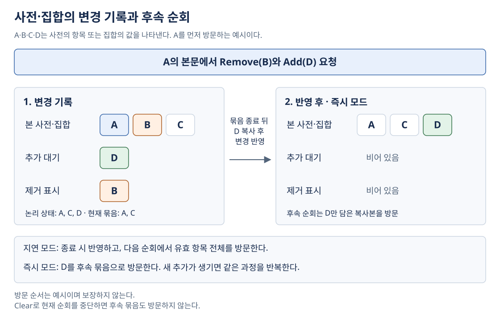

# AdaptiveDictionary

순회 중 키·값의 추가·제거·교체를 허용하는 사전이다.

## 목차

1. 역할과 구성
2. 동작 흐름
3. 설계 기준과 고려사항
4. 구현 연결

## 역할과 구성

- 책임: 키의 유일성을 유지하면서 순회 중 변경 요청을 받아들이고, 조회에 보이는 상태와 순회의 방문 대상을 조율한다.
- 보유 정보: 본 사전, 추가 대기 사전, 제거 키 집합, 재사용할 후속 방문 사전, 구조체 커서, 순회 식별자·중단 상태와 DeferredUpdate 모드이다.

본 사전은 반영을 마친 항목을 보관한다. 추가 대기 사전은 새 항목과 교체할 값을 보관하고, 제거 키 집합은 본 사전에서 아직 지우지 않았지만 더 이상 유효하지 않은 항목을 표시한다.

| 제공 서비스 | 제공 이유 |
| --- | --- |
| Add·Remove·인덱서 | 순회 중에도 키의 등록·삭제·값 교체를 요청하고, 같은 키의 중복 등록을 방지한다. |
| TryGetValue·ContainsKey·Count | 본 사전의 물리 상태에 한정하지 않고 대기 변경을 포함한 논리 상태를 조회하게 한다. |
| GetEnumerator·ForEach | 제거 표시를 반영하고 선택한 모드에 따라 새 키·값의 방문 시점을 정한다. |

공통 열거자와 순회 수명 계약의 구조, 순회 수명 규칙은 [모듈 개요](README.md)에서 설명한다.

## 동작 흐름

순회 중이 아닐 때는 등록·제거·값 교체를 본 사전에 바로 반영한다.

순회가 시작되면 사전은 내부 Dictionary 구조체 커서로 본 사전을 먼저 방문하며, 순회 중 변경은 다음 세 구조의 협력으로 처리한다.

1. 추가할 키가 논리 상태에 이미 존재하면 중복 등록을 거부한다. 새 항목은 추가 대기 사전에 보관한다.
2. 제거할 키가 추가 대기 사전에 있으면 그 추가를 취소한다. 대기에 없고 본 사전에 아직 제거 표시 없이 남아 있으면 제거 키 집합에 표시한다.
3. 방문할 항목의 키가 제거 집합에 있으면 건너뛴다. 본 사전의 실제 삭제는 변경 반영 단계에서 처리한다.

| 모드 | 변경 반영과 후속 방문 |
| --- | --- |
| 기본 지연 모드 | 순회 종료 시 제거와 추가를 본 사전에 반영한다. 대기 항목은 다음 순회부터 방문한다. |
| 즉시 반영 모드 | 현재 방문 묶음을 마치면 대기 항목을 재사용하는 후속 방문 사전에 복사하고 변경을 반영한 뒤 이어서 방문한다. 새 대기 항목이 생기면 같은 버퍼를 비워 다시 사용한다. |

조회는 추가 대기 사전을 먼저 확인하고, 그곳에 없는 키는 본 사전에서 제거 표시를 제외하여 찾는다. Count도 본 사전의 수에서 제거 키 수를 빼고 대기 항목 수를 더한다. 따라서 지연 모드에서도 새 항목을 조회할 수 있지만 현재 순회의 방문 대상에는 포함되지 않는다.

순회 중 인덱서의 값 교체는 Remove 후 Add로 처리한다. 이전 값은 이후 방문에서 제외되고 새 값은 추가 대기 사전에 들어간다. 지연 모드에서는 다음 순회에 새 값을 읽으며, 즉시 모드에서는 후속 방문에 포함되므로 이미 방문한 키도 새 값으로 다시 방문할 수 있다.

Clear는 본 사전과 두 변경 기록을 비우고 현재 순회를 중단한다. Clear 이후의 추가는 대기 사전에 보관되며, 현재 순회가 끝날 때 반영되어 다음 순회에서 방문한다.

## 설계 기준과 고려사항

본 사전을 방문하는 동안 일반 추가·제거로 원본 구조를 바꾸지 않도록 변경 기록을 분리한다. 즉시 모드에서도 이 구조를 유지하고, 새 항목을 현재 순회의 후속 방문에 포함하는 방식으로 [공통 변경 원칙](README.md)을 구현한다.

- Keys·Values와 CopyTo는 순회 중 사용할 수 없다.
- 제거 표시가 없는 동안에는 방문 항목마다 제거 키 집합을 조회하지 않으므로 키의 해시 코드도 계산하지 않는다.
- 후속 방문 사전은 새로 생성하지 않고 용량을 재사용하며, 순회 종료와 Clear에서 항목 참조를 비운다.
- 비제네릭 IDictionary 열거는 구조체 열거자를 감싸는 어댑터 객체를 생성한다.

## 구현 연결

[소스](../../../../src/02-Core/02-E.2-AdaptiveCollections/AdaptiveDictionary.cs) · [모듈 구성](README.md)
