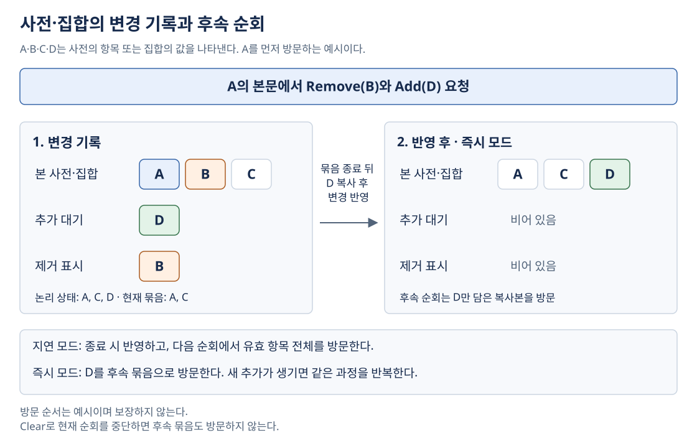

# AdaptiveHashSet

중복 값을 저장하지 않으면서 순회 중 추가·제거를 허용하는 집합이다.

## 목차

1. 역할과 구성
2. 동작 흐름
3. 설계 기준과 고려사항
4. 구현 연결

## 역할과 구성

- 책임: 값의 유일성을 유지하면서 순회 중 변경 요청을 받아들이고, 논리적으로 유효한 값만 방문하게 한다.
- 보유 정보: 본 집합, 추가 대기 집합, 제거 집합, 재사용할 후속 방문 집합, 구조체 커서, 순회 식별자·중단 상태와 DeferredUpdate 모드이다.

본 집합은 반영을 마친 값을 보관한다. 추가 대기 집합은 아직 본 집합에 합치지 않은 값을 보관하고, 제거 집합은 본 집합에 남아 있지만 이후 방문에서 제외할 값을 표시한다.

| 제공 서비스 | 제공 이유 |
| --- | --- |
| Add·AddRange·Remove·Clear | 순회 중에도 값의 등록 수명을 변경하며 이미 존재하는 값의 중복 등록을 방지한다. |
| Contains·Count | 본 집합의 물리 상태에 한정하지 않고 대기 추가·제거를 반영한 논리 상태를 조회하게 한다. |
| GetEnumerator·ForEach | 제거 표시를 반영하고 선택한 모드에 따라 새 값의 방문 시점을 정한다. |

공통 열거자와 순회 수명 계약의 구조, 순회 수명 규칙은 [모듈 개요](README.md)에서 설명한다.

## 동작 흐름

순회 중이 아닐 때는 추가·제거를 본 집합에 바로 반영한다.

순회가 시작되면 집합은 내부 HashSet 구조체 커서로 본 집합을 먼저 방문하며, 순회 중 변경은 다음 세 구조의 협력으로 처리한다.

1. 추가할 값이 논리 상태에 이미 존재하면 추가를 무시한다. 없는 값만 추가 대기 집합에 넣는다.
2. 제거할 값이 추가 대기 집합에 있으면 그 추가를 취소한다. 대기에 없고 본 집합에 아직 제거 표시 없이 남아 있으면 제거 집합에 표시한다.
3. 방문할 값이 제거 집합에 있으면 건너뛴다. 본 집합의 실제 삭제는 변경 반영 단계에서 처리한다.

| 모드 | 변경 반영과 후속 방문 |
| --- | --- |
| 기본 지연 모드 | 순회 종료 시 제거 값을 본 집합에서 빼고 대기 값을 합친다. 대기 값은 다음 순회부터 방문한다. |
| 즉시 반영 모드 | 현재 방문 묶음을 마치면 대기 값을 재사용하는 후속 방문 집합에 복사하고 변경을 반영한 뒤 이어서 방문한다. 새 대기 값이 생기면 같은 버퍼를 비워 다시 사용한다. |

Contains는 추가 대기 집합을 먼저 확인하고, 그곳에 없는 값은 본 집합에서 제거 표시를 제외하여 찾는다. Count도 본 집합의 수에서 제거 값 수를 빼고 대기 값 수를 더한다. 따라서 지연 모드에서도 새 값을 조회할 수 있지만 현재 순회의 방문 대상에는 포함되지 않는다.

본 집합의 값을 제거했다가 같은 순회에서 다시 추가하면 새 추가로 취급한다. 기존 값의 제거 표시는 유지하고 새 값은 대기 집합에 넣으므로, 다시 방문하는 시점은 선택한 추가 반영 모드를 따른다.

Clear는 본 집합과 두 변경 기록을 비우고 현재 순회를 중단한다. Clear 이후의 추가는 대기 집합에 보관되며, 현재 순회가 끝날 때 반영되어 다음 순회에서 방문한다.

## 설계 기준과 고려사항

본 집합을 방문하는 동안 일반 추가·제거로 원본 구조를 바꾸지 않도록 변경 기록을 분리한다. 즉시 모드에서도 이 구조를 유지하고, 새 값을 현재 순회의 후속 방문에 포함하는 방식으로 [공통 변경 원칙](README.md)을 구현한다.

- 집합의 유일성은 유지하지만 방문 순서를 보장하지 않는다. 제거 후 재추가한 값은 즉시 모드에서 같은 순회에 다시 나타날 수 있다.
- CopyTo는 순회 중 사용할 수 없다.
- 제거 표시가 없는 동안에는 방문 값마다 제거 집합을 조회하지 않으므로 값의 해시 코드도 계산하지 않는다.
- 후속 방문 집합은 새로 생성하지 않고 용량을 재사용하며, 순회 종료와 Clear에서 항목 참조를 비운다. 변경 반영도 구체적인 집합을 직접 순회하여 인터페이스 박싱을 피한다.

## 구현 연결

[소스](../../../../src/02-Core/02-E.2-AdaptiveCollections/AdaptiveHashSet.cs) · [모듈 구성](README.md)
