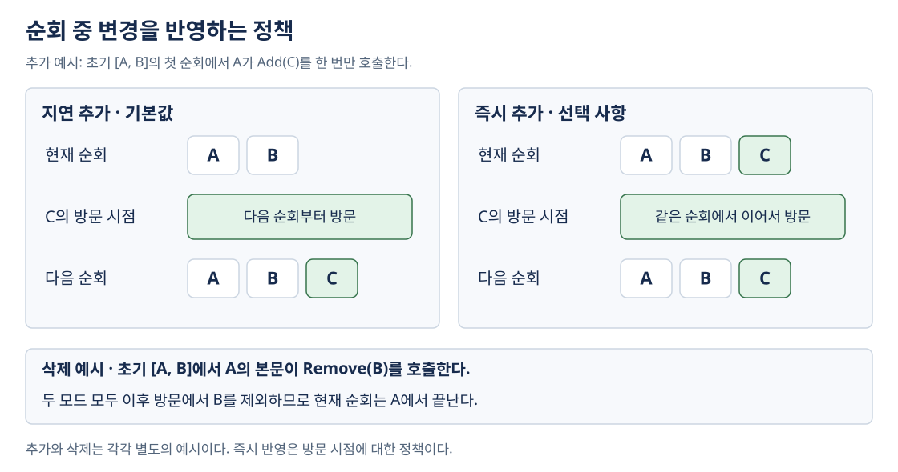
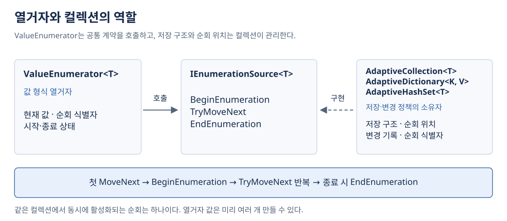

# Adaptive Collections

순회 중 변경을 허용하면서 변경 반영 시점을 제어하는 컬렉션 모음이다.

## 목차

1. 소개
2. 변경 정책과 설계 원칙
3. 구성과 역할
4. 대표 흐름
5. 구현과 검증 범위
6. 상세 문서

## 소개

| 항목 | 설명 |
| --- | --- |
| 개요 | 순회 중 변경을 다루는 컬렉션이다. |
| 목적 | 항목의 등록·해제 요청을 받아들이면서 진행 중인 순회의 방문 대상을 일관되게 결정한다. |
| 구현 | 컬렉션이 순회 위치와 대기 변경을 관리하고 추가 반영 시점을 선택하게 한다. |

## 변경 정책과 설계 원칙

순회 도중에도 항목의 등록과 해제는 발생할 수 있다. Adaptive Collections는 변경 요청을 받아들이면서, 새 항목이 언제부터 참여하고 제거한 항목을 언제부터 제외할지 정한다.

| 정책 | 현재 순회의 방문 대상 | 선택 이유 |
| --- | --- | --- |
| 지연 추가·기본값 | 순회 도중 추가된 항목은 다음 순회부터 방문한다. | 전파를 처리하는 도중 생긴 구독이 현재 전파의 참여 범위를 늘리지 않게 한다. |
| 즉시 추가·선택 사항 | 기존 항목에 이어 새 항목도 같은 순회에서 방문할 수 있다. | 등록된 수신자가 현재 전파에도 참여해야 하는 요구를 지원한다. |
| 즉시 삭제 반영·공통 | 제거한 등록 항목은 이후 방문에서 제외한다. | 해제된 연결을 통해 삭제된 객체에 다시 접근하는 것을 막는다. |

기본 지연 추가와 즉시 삭제 반영은 [이벤트](../../../01.%20Concepts/04.%20이벤트.md)의 '이벤트 전파 도중의 수신자 변경과 처리' 원칙을 따른다. 지연 추가는 새 항목의 방문 시점에 대한 정책이며, 전체 컬렉션의 복사본을 순회한다는 구현을 뜻하지 않는다. 즉시 추가는 현재 전파에도 참여해야 하는 경우 선택하는 확장 정책이다.

삭제 정책은 [객체 활동과 연결 원칙](../../../01.%20Concepts/03.%20객체%20활동과%20연결%20원칙.md)의 '삭제의 무결성'과 '활동의 존중'을 순회에 적용한 것이다. 제거한 연결을 이후 방문에서 제외하여 삭제 뒤 남은 연결이 다른 객체의 활동을 방해하거나, 접근해서는 안 되는 객체의 영역으로 전파가 이어지는 것을 방지한다.

여기서 즉시는 방문 대상에 대한 효과이다. 실제 저장소의 변경은 자료구조에 따라 즉시 처리하거나 안전한 반영 단계까지 미룬다. 이미 실행 중인 콜백 본문은 반환될 때까지 실행되며, 항목 하나의 제거가 전체 순회를 중단시키지는 않는다.

조회에 보이는 논리 상태와 현재 순회의 방문 대상도 구분한다. 지연 추가된 항목은 Count·Contains 계열의 조회에 포함되지만 현재 순회에서는 방문하지 않는다. 제거한 항목은 조회와 이후 방문에서 제외한다.

## 구성과 역할

AdaptiveCollection은 목록의 순회 인덱스를 직접 관리하여 추가·삭제에 맞춰 다음 방문 위치를 보정한다. AdaptiveDictionary와 AdaptiveHashSet은 대기 항목·제거 표시를 통해 원본 저장소의 열거를 유지한다. AdaptiveAction은 목록의 순회 정책에 콜백 실행과 예외 보고를 더한다. 같은 변경 원칙을 공유하지만 저장 구조별 열거 방식은 다르다.

열거 방식이 달라도 순회 수명은 같은 계약으로 다룬다. AdaptiveCollection·AdaptiveDictionary·AdaptiveHashSet은 순회 수명 계약인 [IEnumerationSource](../01-O.2-Interfaces/IEnumerationSource.md)를 명시적으로 구현하고, GetEnumerator에서 그 계약을 호출하는 구조체 열거자 [ValueEnumerator](../01-O.3-Objects/ValueEnumerator.md)를 반환한다. AdaptiveAction은 AdaptiveCollection을 상속하여 같은 계약을 사용한다. 열거자는 시작·이동·종료만 요청하고 저장 구조·순회 위치·변경 기록은 각 컬렉션이 소유하므로, 공통 열거자는 구체 컬렉션에 의존하지 않는다.

## 대표 흐름

1. GetEnumerator는 열거자 값만 만든다. 첫 MoveNext에서 컬렉션이 순회를 시작하고 순회 식별자를 발급한다.
2. 이동마다 컬렉션이 현재 방문 대상과 변경 상태를 관리한다. 삭제한 항목은 이후 방문에서 제외하며, 추가는 선택한 모드에 따라 현재 또는 다음 순회에 반영한다.
3. 끝에 도달하거나 열거자를 폐기하면 종료 계약에서 남은 변경의 반영을 시도하고 finally에서 순회 상태를 복구한다. foreach의 break·return·본문 예외도 열거자 폐기로 이어지며, 직접 열거자를 다루는 호출자는 조기 종료 시 폐기해야 한다.

## 구현과 검증 범위

모든 컬렉션의 직접 순회는 ValueEnumerator를 사용한다. AdaptiveDictionary·AdaptiveHashSet은 즉시 모드의 후속 방문 버퍼를 재사용하며, AdaptiveAction은 등록 시 준비한 호출 목록을 재사용한다. 초기화·등록과 필요한 용량 확보 이후에는 직접 순회와 콜백 호출을 위한 반복 할당이 없다. 인터페이스 순회의 박싱, 용량 확장, 사용자 콜백·비교·해시 코드와 예외 생성은 별도이다.

순회 수명은 세 컬렉션에 공통으로 다음 규칙을 따른다.

- 중첩 순회: 여러 열거자 값을 만들 수 있지만 같은 컬렉션에서 동시에 별도 순회를 활성화할 수는 없다. 이미 순회 중이면 새 열거자의 첫 MoveNext에서 InvalidOperationException으로 거부하며 기존 순회를 바꾸지 않는다.
- 식별자: 각 순회에 별도 ID를 부여하여 오래된 열거자가 새 순회를 조작하지 못하게 한다.
- 시작 후 복사: 복사본은 같은 소스 순회를 공유한다. 각 Current는 자신이 마지막으로 받은 값이며 독립적인 방문 위치를 만들지 않는다.
- 종료 후 복사본: 한 복사본이 종료한 순회를 다른 활성 복사본으로 이동하면 InvalidOperationException이다. 중복 종료와 오래된 ID의 종료 요청은 무시한다.
- 시작 전 복사: 각 복사본이 시작을 요청할 수 있지만 같은 컬렉션의 중첩 순회 금지는 그대로 적용된다.
- ForEach는 콜백 예외를 격리하지 않는다. 예외는 열거자 폐기를 통한 순회 정리 후 호출자에게 전파되며, 콜백 실패 항목의 제거와 보고는 AdaptiveAction이 추가로 제공하는 정책이다.

시작 전 폐기, 기본값 열거자, Current·Reset과 정리 예외의 동작은 [ValueEnumerator](../01-O.3-Objects/ValueEnumerator.md)의 수명 규칙을 따른다. 스레드 간 동시 순회·변경을 보장하지 않는다.

공개 GetEnumerator 반환형은 ValueEnumerator&lt;T&gt;이므로, IEnumerator&lt;T&gt;를 반환하던 이전 바이너리 소비자는 다시 빌드해야 한다. IEnumerable·IEnumerable&lt;T&gt; 경로는 표준 소비 코드와의 호환성을 위해 유지한다. 순회 계약·열거자·컬렉션 구현은 본체 프로젝트의 대상인 C# 9와 .NET Standard 2.1에서 지원하는 기능만 사용한다.

[상태·동작 표](../../../../tests/02-Core/02-E.2-AdaptiveCollections/UniTest/01-Tables.md), [테스트 계획](../../../../tests/02-Core/02-E.2-AdaptiveCollections/UniTest/02-Plans.md), [검증 결과](../../../../tests/02-Core/02-E.2-AdaptiveCollections/UniTest/03-Results.md)는 공통 순회 수명, 각 컬렉션의 대표 변경 동작과 반복 할당 검증을 기록한다.

## 상세 문서

| 객체·계약 | 역할 |
| --- | --- |
| [AdaptiveCollection](AdaptiveCollection.md) | 순회 인덱스를 직접 보정하는 목록 기반 컬렉션이다. |
| [AdaptiveAction](AdaptiveAction.md) | 순회 중 콜백 변경과 수신자 예외 격리를 지원하는 호출 목록이다. |
| [AdaptiveDictionary](AdaptiveDictionary.md) | 순회 중 키·값의 추가·제거·교체를 허용하는 사전이다. |
| [AdaptiveHashSet](AdaptiveHashSet.md) | 중복 값을 저장하지 않으면서 순회 중 추가·제거를 허용하는 집합이다. |

[그림과 편집 원본](Resources/README.md) · [Core 구성](../README.md)
